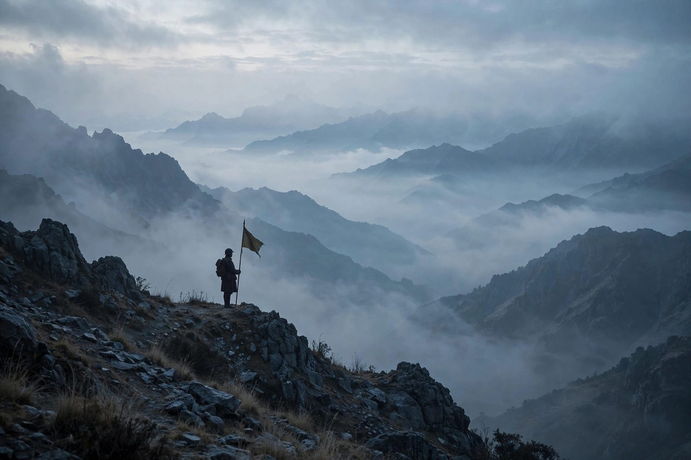

1962 年对中国来说，是不平凡的一年。这一年，中印边境打响了自卫反击战，古巴导弹危机把世界推到核战争边缘，中苏关系彻底交恶。也是在这一年，有人画了一张中国与世界的外交关系图，把整个世界涂成了五种颜色。

黑色、红棕色、鲜红色、红色、白色。五种颜色，就是五种态度。图上看去，中国周围几乎没有白色。

（题图为 AI 绘制的示意图，还原的是那张五色外交关系图的观感，并非 1962 年原图。）

## 五种颜色，一把标尺

这张图的分类标准很直白，不看口号，只看行动：有没有打仗、有没有封锁、封锁到什么程度。

| 颜色 | 含义 | 判定标准 |
| --- | --- | --- |
| 黑色 | 直接军事冲突 | 与中国发生直接军事冲突的国家 |
| 红棕色 | 极度不友好 | 对华实施全面封锁交往、军事对峙的国家 |
| 鲜红色 | 不友好 | 对华实施大规模封锁交往的国家 |
| 红色 | 不友好 | 对华实施部分封锁交往的国家 |
| 白色 | 一般及以上 | 与中国外交关系达到一般及以上水平的国家 |

标准定下来，再按这个标尺一个国家一个国家地量，1962 年的世界就显出了真面目。

## 美洲：除了古巴，一片红色

1962 年的美洲，除古巴之外，没有一个国家与中国正式建交。

这不是偶然。1954 年，美洲国家组织集体通过决议，不承认新中国，把共产主义视为核心威胁。到了 1962 年，古巴导弹危机爆发，美洲国家集体反苏，顺带把对华的外交封锁也推到了顶峰。

但即便在铁板一块的美洲，也有两处裂缝。

巴西推行独立不结盟外交，允许中国贸促会代表团访巴，两国民间商品贸易一直没断。中印冲突中，巴西没有支持中国，但也没有跟着封锁，判定为红色——部分封锁。

玻利维亚的经济高度依赖矿产品出口，政府没有强行关停民间小额对华商贸渠道，同样判定为红色。

也就是说，美洲的红色不是铁板一块，而是美国主导的集体封锁之下，两个靠民间经贸留了口气的例外。

## 亚洲：家门口的棋局

亚洲是这张图上颜色最复杂的地方，也是离中国最近、最要紧的地方。

### 东亚：三色分明

| 国家 / 地区 | 颜色 | 判定要点 |
| --- | --- | --- |
| 中国台湾地区 | 红棕色 | 获得美国提供的船机武器支持，骚扰中国大陆周边沿海 |
| 韩国 | 红棕色 | 朴正熙军政府统治，依托韩美共同防御条约对华高度封锁，民间交往完全中断 |
| 日本 | 鲜红色 | 签署日美安保条约，站在美国阵营，但 60 年代仍保留中日民间贸易往来 |
| 朝鲜 | 白色 | 金日成执政时期明显偏向中国，中印冲突中公开支持中国，全面开放双边往来 |

日本这一格最值得玩味：政治上站在美国一边，经济上却舍不得断了和中国的民间贸易。鲜红色，而不是红棕色，差的就是这点民间往来。

### 南亚：唯一的黑色

1962 年，全世界只有一个国家被涂成黑色：印度。

这一年，中印边境爆发自卫反击战，两国发生直接军事冲突。黑色，是这张图上最重的颜色，也只给了印度一个国家。

印度之外，南亚的另外三个邻国走了另一条路。巴基斯坦、阿富汗、尼泊尔整体持中立态度，没有采取对华敌对封锁措施。而不丹的外交事务受印度控制，对华实施部分封锁，判定为红色。

一个有意思的细节是：巴基斯坦明明是东南亚条约组织（1954 年加入）和巴格达条约组织（1955 年加入，后改称中央条约组织）的成员国——两个美国主导的反共军事同盟，当时前者还常被称为“亚洲的北约”——却在中印冲突中支持中国。阵营和立场，在这里并不重合。

### 东南亚：东约的包围圈

东南亚的红棕色连成了一片，背后是一个组织：东南亚条约组织，简称东约。

“东约创办之初就是为了阻止共产主义在东南亚扩散，说得更直白点，就是专门针对北越和中国的组织。”

| 国家 | 颜色 | 判定要点 |
| --- | --- | --- |
| 菲律宾 | 红棕色 | 东约核心成员，常年开展美菲联合军演，允许台湾特务船机停靠，中印冲突中公开支持印度 |
| 泰国 | 红棕色 | 东约总部所在地，不承认新中国，经济上支持台湾在云南的武装活动，扶持反华势力 |
| 南越 | 红棕色 | 1962 年底境内驻有 11300 余名美军，配合美军在靠近中国广西的岛屿活动，协助美军海陆空三重封锁中国 |

三国的共同点很清晰：境内有美军基地，配合美军对华封锁。

东南亚的其他国家，颜色就杂了。老挝处于内战状态，境内三方势力立场分化，联合过渡政府的武装对华持中立态度，部分势力受美国支持、持反华立场。缅甸、柬埔寨由奈温、西哈努克执政，官方明确持中立外交立场。马来亚、新加坡、沙捞越、沙巴、文莱受英国通过一系列条约严格限制，无法自主开展对华外交。

最耐人寻味的是印尼。苏加诺执政时期，印尼受多重内外因素制约，没有与中国走近，判定为红色。这个“没有走近”，间接影响了后来的历史——1965 年的九三零事件，以及 1967 年中印尼断交。

## 曾经的“老大哥”：苏东阵营

1962 年的图上，苏联是鲜红色。

这很刺眼。十年前，苏联还是“老大哥”，是一边倒的对象。六年之间，关系急转直下。

| 时间 | 关键节点 |
| --- | --- |
| 1956 年 | 苏共二十大，赫鲁晓夫全盘否定斯大林，中苏意识形态分歧公开化 |
| 1958 年前后 | 苏联提出联合舰队、长波电台等合作方案，涉及中国主权，中方拒绝，两国互信进一步破裂 |
| 1962 年 | 中印冲突爆发，苏联公开支持印度并提供军事援助；同年策动新疆塔城事件、伊宁暴乱 |

从意识形态分歧，到主权问题上的较量，再到中印冲突中站到对立面、策动边疆骚乱——苏联的鲜红色，是一步一步加上去的。

苏联的卫星国也没能例外。蒙古国作为苏联的卫星国，同步采取反华立场，但中蒙民间仍保留交流，判定为红色。华约其他国家多数依附苏联采取反华立场，只有阿尔巴尼亚、罗马尼亚没有服从苏联的指令，其中阿尔巴尼亚与中国立场相近。

阵营内部，也不是铁板一块。

## 欧洲与中东：裂缝里的光

欧洲和中东，是这张图上少数有白色的地方。而这些白色的来由，往往和美国无关，甚至和美国过不去。

葡萄牙是白色。1961 年，印度武力占领了葡萄牙统治数百年的果阿，英美对此毫无反应，葡萄牙被激怒。到了 1962 年中印冲突，葡萄牙公开支持中国。正是这个原因，葡属帝汶在 1962 年保持了中立。

法国是红色。法国虽然是北约成员国，但长期不满美国的干涉。1962 年阿尔及利亚战争结束后，中法关系缓和。两年后，1964 年，中法正式建交——这是法国脱离美苏两极格局的一步棋。

中东同样暗流涌动。北也门在 1962 年革命后与中国建立友好关系，双边往来顺畅。巴林、卡塔尔、特鲁西尔（今阿联酋）都是英国的保护国，受英国指令对华实施大规模封锁，判定为鲜红色。阿曼在 1962 年爆发反抗英国殖民统治的佐法尔战争，中国支持反殖民叛军，判定为鲜红色。伊朗在巴列维推翻摩萨台政府后加入巴格达条约组织，亲美反苏，同步对华敌对——但到了 1971 年，为了共同对抗苏联，伊朗与中国的关系快速升温。

## 非洲：沉默的大陆

1962 年的非洲，在这张图上几乎是沉默的。多数国家仍是殖民地，或者受大国深度控制，还没有机会在图上表达自己的颜色。

但九年之后，非洲发出了声音。1971 年，新中国重返联合国，非洲是投反对票最多的大洲，一共 15 票反对。沉默的大陆，并不是没有立场。

## 一张表，看完 1962

| 颜色 | 国家 / 地区 |
| --- | --- |
| 黑色 | 印度 |
| 红棕色 | 中国台湾地区、韩国、菲律宾、泰国、南越 |
| 鲜红色 | 日本、苏联、巴林、卡塔尔、特鲁西尔（今阿联酋）、阿曼 |
| 红色 | 巴西、玻利维亚、不丹、蒙古国、印度尼西亚、法国 |
| 白色 | 古巴、朝鲜、葡萄牙、北也门 |

另外，巴基斯坦、阿富汗、尼泊尔、缅甸、柬埔寨持中立立场，未采取对华敌对封锁措施；老挝内战中各方立场分化；马来亚、新加坡、沙捞越、沙巴、文莱受英国条约限制，无法自主开展对华外交。

## 结语：从“一边倒”到独立外交

1962 年，中国同时面对美国和苏联两个集团的封锁。东边是美军基地和东约的包围圈，西边是曾经的盟友调转了枪口。地图上的红色从四面八方压过来，白色只剩下零星几点。

但也正是在这一年，中国放弃了“一边倒”的策略。

“1962 年对中国来说是不平凡的一年，这一年，美苏集团双重封锁，也让中国放弃了一边倒的策略，走向了独立外交的漫长征程。”

这张五色地图，画的不是终点，而是一个起点。从那一年起，中国的外交不再依附于任何一个阵营，而是一步一步，走出自己的路。

