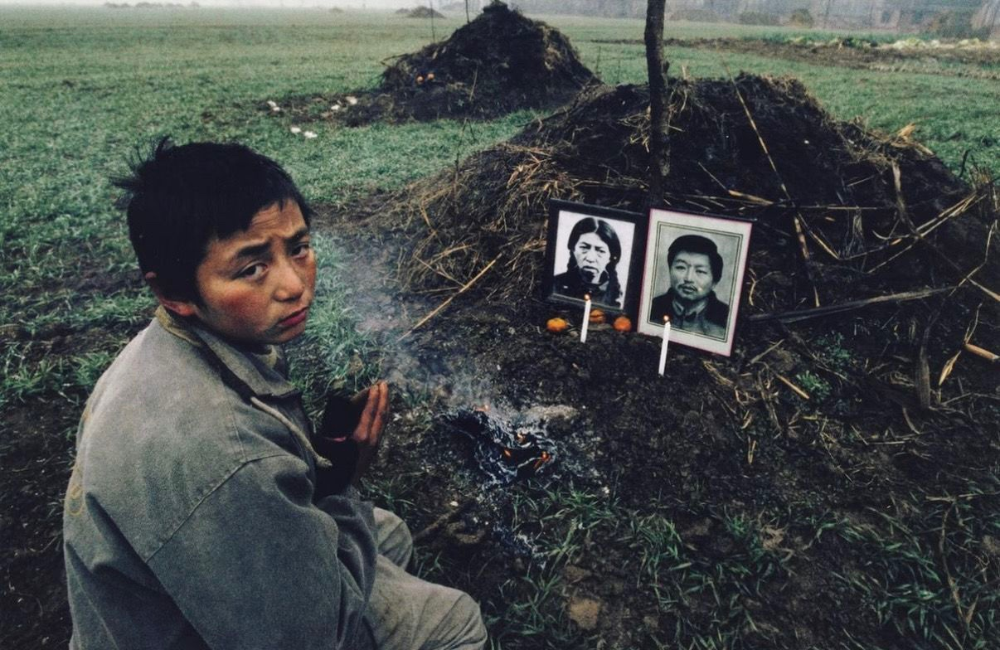

本文转载自抖音博主佯想云彩（抖音号：2241227819）。

这张照片，我一直不太敢看第二眼。这倒不是因为我心软，心软的人看了会难受，我看了只会觉得自己不是东西；主要是看了也没用，所以就更不敢看。但后来我又想，看一眼和看两眼，对照片里的人其实没有分别，有分别的是我，所以我还是把它调出来，看了很久。

照片是卢广在2001年末在河南上蔡拍的。那地方那几年在新闻里有个名字，叫艾滋村。

事情得从九十年代说起。那时候有人下乡收血，抽一点，给钱。农民算了算，觉得这事跟去河里挑水差不多，水是身上的，抽出去还能长回来，几十块钱可是实打实的，够给娃买双新鞋，够割两斤猪肉，于是排队。

血站的操作，我后来看过一些记载：血抽出来，用离心机把血浆分走，血浆值钱；剩下的是红细胞，红细胞不值钱，不值钱的东西不能扔，扔了可惜，于是兑上生理盐水，再输回各人的血管。这里头有个技术问题，几百个人的红细胞混在一个桶里，只要其中有一个人带着病毒，这一桶就全废了。不，比全废还糟，这一桶会均匀地把病毒分给每一个人，一个不落。

按理说，这个道理不难懂，可当时没人往这上头想。我替他们想过，一根针头几毛钱，换一根，一年也花不了多少。但血站老板不这么想，他看的是今天，今天多赚几毛就是几毛；农民也不这么想，他看的是眼下，眼下娃要上学，要吃饭。两边都没错，可这两样凑到一块儿，就要命了。硬要说谁错了，是血站老板，他漏掉了一样东西，人命。后来病毒也掺和进来了，病毒不认钱，只认人。

照片里是这件事的结尾。冬天的麦苗是绿的，贴着地皮长，两座坟夹在绿里，是那块地上唯一不长东西的地方。坟不高，土是深褐色的，上面压了一层枯草，大概是怕被风刮走；没有碑，没有水泥，也没有砖，两张黑白遗像直接靠在坟头的草上，一边一张，一男一女，风大一点，它们就会倒。一个人死了，连张照片都得靠草撑着，这事说起来不太好听，可照片上就是这样，我也不能替他们添一块碑。

坟前供着三个橘子，皮已经皱了，两根白蜡烛都点着，火苗很小，有点弯。蜡烛是新点的，这说明有人来过，至于是谁，照片里没有。

男孩跪在左边那座坟前，十来岁，一件灰绿色的外套，大出好几号，领口有拉链，拉到一半，袖子太长，把手腕盖住了；风把衣服吹起来，空荡荡地贴在背上。那件衣服多半是他爹的，这个判断不需要什么证据，看尺寸就够了。

黄纸在烧，没有明火，只冒青白色的烟，烟往上走，走到他面前，偏了一下，绕过脸，往右上去了。他没有动，眼睛一直睁着。我在这头，下意识地偏了一下头，照片里并没有烟扑到他脸上，我还是偏了一下。人有时候会躲一些并不存在的东西，这大概说明，有些东西是真的。

纸灰飘起来，落在他鼻梁上，他也不擦。他就像一块石头。

这烟是烧给死人的。死人在土里烂着，活人在烟里呛着，这话听着挺工整，可事情就是这样。要是不烧，这坟前就剩两堆土。

他双手合十，贴在胸口，姿势很规矩，像是有人教过，练过。他在求谁呢，这个我不知道。他面前的爹妈已经成了鬼，头顶的老天爷一声不吭，所谓天聋地哑，大概就是这样。这四个字太整齐了，整齐得让人不太敢信。他要真求了什么，我也听不见，就不替他编了。

按说这种时候该哭。他没哭，也许是哭不出来，也许是早就哭过了。这地方荒，哭给谁看呢，哭完了，也没有人替他拍掉肩上的灰，没有人替他交下学期的学费。

我小时候听过一句话，叫善有善报。这话的好处是省事，报应推到以后，眼下就不用管了。可眼下这个样子，报应要等到什么时候，我看不出来。有些苦是熬得过去的，熬过去就叫经历，将来还能写进书里；有些苦熬不过去，熬不过去就不叫经历，叫白熬。穷是没钱，这地方比没钱还多一层，连哭都要先想想有没有用。

坟前那三个橘子，我看了很久。我对体面这件事一直有点意见：城里人办丧事，要设灵堂，要念悼词，要说死者一生勤勤恳恳、艰苦朴素；这里的体面是三个橘子，两根蜡烛，按一般的标准，这算不上体面。但我又想，体面是给活人看的，三个橘子摆在那儿，是为了让路过的人知道，这家人还没忘，忘了就真的什么都没有了。所以这三个橘子，比很多悼词都管用。

那几年，外面的世界很热闹，千禧年，申奥，敲钟，电视里天天有事。这些事跟这个孩子没有关系，这也很正常，电视里的事跟大多数人都没有关系，大多数人的日子是另一套，不上电视。远处的地里还有一座坟，一样的土包，没有遗像，有遗像的，说明还有人记得，没有的，就不好说了。

这张照片我存了下来，放在一个不常打开的文件夹里，有时候想起来，打开看一眼，然后关上。我写这篇文章，老实说，不是为了他，是因为我看了照片，心里不舒服，写出来会舒服一点，这么一想，我又觉得自己不是东西。可我也做不了别的，我既不能让他爹妈活过来，也不能替他交上那个学期的学费，我能做的，就是记住有这么一件事，有这么一个人，在2001年的冬天，跪在两座没有碑的坟前。

记住这件事，对他没有用，对我有一点用。这大概就是所谓的意义，虽然我不太喜欢这个词。
