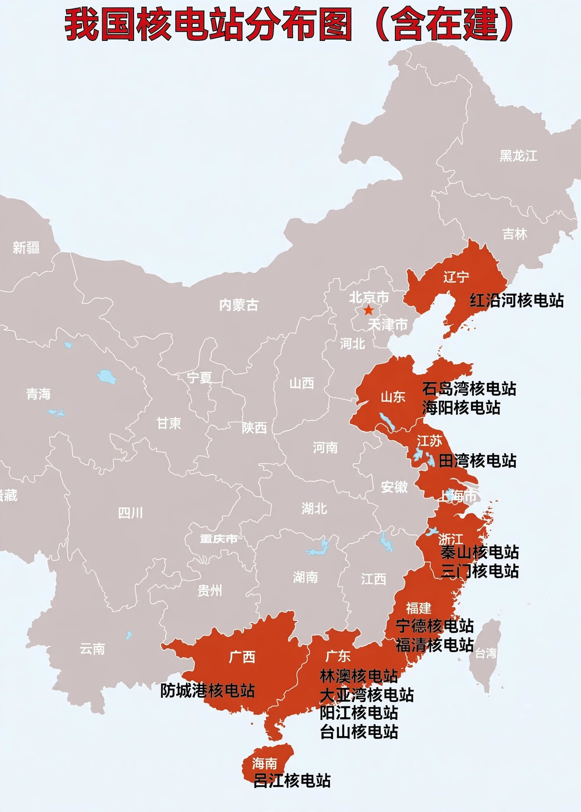
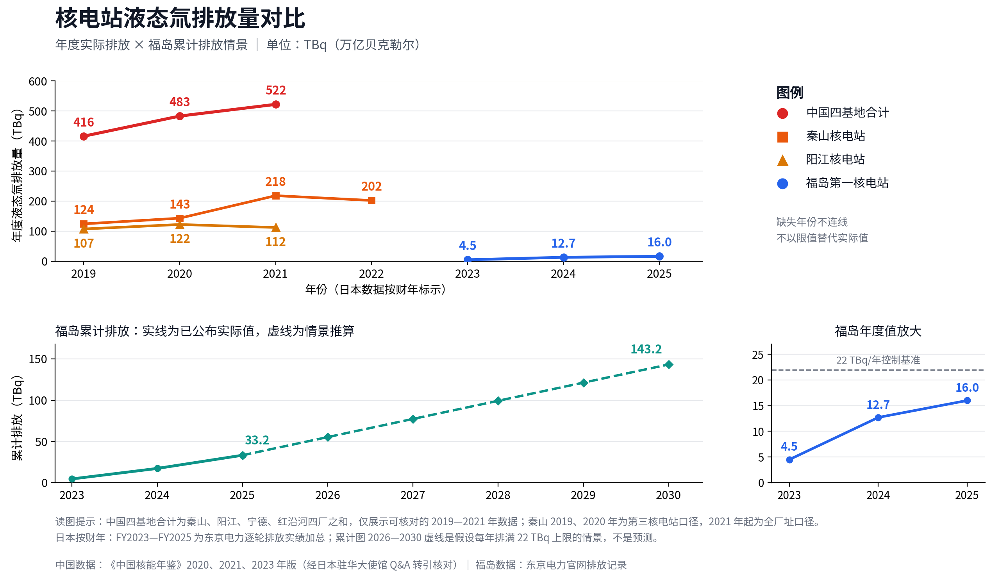

2023 年福岛开始排海，中国这边是外交部连番抗议、海关总署全面暂停日本水产进口、官媒连篇累牍，全网沸腾，仿佛这一排，太平洋就要毁天灭地。但很少有人问另一个问题：我们自己的核电站，每年往海里排多少？数据都是公开的，只是没人告诉你——或者说，有人不想让你知道。

先认识一下主角。氚是氢的放射性同位素，半衰期 12.3 年，它会和水结合成氚化水，混在水里，现有的技术无法把它分离出来。记住这一点：福岛去不掉氚，中国的核电站同样去不掉。单位用 TBq，1 TBq 就是 1 万亿贝克勒尔，日本人说的“兆贝克”也是它。

## 十几座核电站，贴着海岸线排

红沿河、石岛湾、海阳、田湾、秦山、三门、宁德、福清、防城港、岭澳、大亚湾、阳江、台山、昌江——十几座核电站（含在建），全部建在沿海。这不是巧合：核电站运行产生的放射性废液，最终的归宿就是近岸海域。

## 排什么，怎么排

核电站的放射性排放分两路：

**液态流出物（排海）**：一回路冷却水等废液先收集贮存，经过蒸发、离子交换、过滤等处理，取样检测合格后批量排放，跟着电厂的循环冷却水一起排进近岸海域。其中占绝对大头的是氚，其次是碳-14，其余核素（铯、锶、钴等）含量很低，中国政府定的标准对滨海厂址的要求是：除氚和碳-14 外，其余核素浓度不超过 1000 Bq/L。

**气载流出物（排天）**：废气经过高效过滤器、碘吸附器处理，再贮存衰变一段时间，从高烟囱排入大气。里面有惰性气体（氪、氙）、碘-131、气溶胶颗粒、碳-14 和气态氚。

处理技术的边界要说清楚：蒸发、离子交换、过滤能去掉大部分核素，唯独氚和水是“一家人”，去不掉，只能靠大量海水稀释后排放。这一点上，中国核电站和福岛用的是同一套物理规律。

## 账本：每年到底排多少

先看中国政府给的额度。中国政府现行的标准 GB 6249-2011 规定：每座 3000MW 热功率的轻水堆，液态氚的年排放控制值是 75 TBq；重水堆更夸张，是 350 TBq。一个厂址有几台机组，额度就叠加几倍——秦山一个厂址有 9 台机组，其中两台还是重水堆。

再看实际排了多少。以下数字出自中国核能行业协会的《中国核能年鉴》（2021、2022），是各电厂自己上报的液态氚年排放量：

| 核电站 | 2020 年 | 2021 年 |
|---|---|---|
| 秦山（浙江） | 143 TBq（仅第三核电站） | 218 TBq（全厂址） |
| 阳江（广东） | 122 TBq | 112 TBq |
| 宁德（福建） | 111 TBq | 102 TBq |
| 红沿河（辽宁） | 107 TBq | 90 TBq |

2021 年，光这四家，合计排了 522 TBq。而这只是十几座核电站里的四家。更新的数据同样难看：2022 年，秦山一家排了 202 TBq；据共同社对《中国核能年鉴》（2023 年版）的统计，全国 13 座核电厂 19 个监测点里，有 15 处的年排氚量超过了福岛 22 TBq 的年上限。

## 和福岛比一比

福岛那边的情况：事故攒下的处理水约 134 万吨，氚总量约 860 TBq（日本经济产业省估算）。处理方式是 ALPS 系统去除氚和碳-14 以外的 62 种核素，再用海水稀释到 1500 Bq/L 以下排放。日本给自己定的年排放上限是 22 TBq，计划用约 30 年排完。2023 年 8 月开始排放，到 2026 年 11 月，三年多累计排了约 42.9 TBq（东京电力官网数据）。

两笔账放一起：

**年度对比**：福岛年上限 22 TBq；秦山一年 218 TBq，是福岛的近 10 倍；阳江 112 TBq，约 5 倍；宁德 102 TBq，约 4.6 倍；红沿河 90 TBq，约 4 倍。就连中国政府自己定的标准——单台轻水堆 75 TBq 的年控制值——都是福岛年上限的 3.4 倍。

**总量对比**：福岛全部库存 860 TBq，要分 30 年慢慢排；中国四座核电站一年就排 522 TBq，相当于福岛总量的六成。换句话说，福岛三十年的总量，这四家不到两年就排完了。福岛实际排了三年多的 42.9 TBq，还不到秦山一年的五分之一。

（注：秦山 2019、2020 年为第三核电站口径，2021 年起为全厂址口径；福岛为东电逐轮排放实绩按财年加总；“四基地合计”仅为四家之和，全国共有十几座核电站。）

## 不只是氚：锶、铯、钴和碳-14

有人会问：排进海里的只有氚吗？不是。液态流出物里还有碳-14，以及锶-90、铯-137、钴-60 等一串核素；气载流出物里还有惰性气体和碘。

以秦山 2022 年的官方核安全年报为例，当年液态流出物中：碳-14（轻水堆）约 0.016 TBq；“其余核素”（锶-90、铯-137、钴-60 等打包计算）轻水堆部分约 0.78 GBq、重水堆部分约 2.6 GBq。气载方面更值得看一眼：气态氚约 108 TBq（也就是说，算上排天的，秦山 2022 年氚的总排放约 310 TBq），气态碳-14 约 1.56 TBq，用掉了年度控制值的三成，还有惰性气体约 3.1 TBq。

这些数字比氚小几个数量级，但性质不同：锶-90 半衰期约 29 年，进了人体会往骨头里钻；铯-137 半衰期约 30 年。更关键的是透明度：中国各厂只公布一个打包的“其余核素”总数，锶单独排了多少、铯单独排了多少，公众无从查起。

福岛那边，ALPS 系统就是冲着锶-90、铯-137 等 62 种核素去的，每批排放前，东电都要公布除氚外各核素的“浓度比总和”（历次在 0.08 到 0.61 之间，法定要求小于 1）。福岛真正的风险点也在这里：据日本环境省文件，储罐里约七成的水一次处理并未达标，必须二次处理后才能排放。一边是把每批水的核素清单摊开给全世界看，一边是只有一个打包数字——哪种更让人放心，不言自明。

## 一边煽动，一边遮掩

2023 年的舆论是怎么起来的，大家都还记得：外交部一场接一场的记者会，海关总署一纸公告全面暂停日本水产进口，“核污染水”四个字天天挂在热搜上，全网义愤填膺。按这个声讨的力度，你会以为中国的核电站干净得像蒸馏水。

事实是另一回事。自家核电站每年排多少氚，数据锁在一年一本的行业年鉴里，滞后一年出版，从没人向公众通报；2022 年之后的数据，至今无处可查。这些数字 2023 年才广为人知，方式很讽刺：是日本驻华大使馆拿着《中国核能年鉴》贴出来回击中方抗议的。也就是说，自家核电站的排放账本，是外国人翻给我们看的。

遮掩还在加码。秦山是全国披露最细的核电站，它的年报原本附有完整的排放数据表，控制值、占比一目了然——2022 年秦山排了 202 TBq，就是从那张表里算出来的。但我把秦山 2023 年的年报原文找来看了：数据表被整张删掉，只剩一句话，“排放量低于中国政府批准的年度控制值，满足法规要求”。排了多少？不告诉你。达标了，就完了。

类似的事不止一次。2021 年台山核电站一回路惰性气体浓度升高、燃料棒破损，中国公众是从 CNN 的报道里先知道的，之后中国政府才出来通报：约 5 根燃料棒破损（堆内共 6 万多根），厂外辐射未见异常。事情本身不大，但顺序很说明问题。

一边把 22 TBq/年渲染得像亡国灭种，一边把自家 218 TBq/年的账本锁进抽屉——这不是环保，这是把核安全当舆论武器：需要煽动的时候，标准比谁都严；轮到自己的时候，连数字都不必有。

## 结尾

这篇文章不是要替福岛洗地。福岛排的是事故污染水，该不该排、ALPS 靠不靠谱，是另一笔账。这里只摆一个简单的事实：如果 22 TBq/年的排放值得全民声讨、值得禁止进口日本水产，那么每年 90 到 218 TBq、合法排进中国近海的氚，至少值得全民知情。十几座核电站就贴在我们的海岸线上，离它们最近的海鲜市场，可能比离福岛的近得多。

把这些数字摆出来，不为别的：一是让你知道自己家门口排的是什么、排了多少；二是下次再有人煽动你为 22 TBq 义愤填膺的时候，想一想，这愤怒是谁递到你手里的。

（数据来源：《中国核能年鉴》2021、2022、2023；日本驻华大使馆“处理水相关 Q&A”；东京电力官网排放实绩；秦山核电《核安全信息公开年度报告（2022 年）》《核安全信息公开年度报告（2023 年）》；GB 6249-2011《核动力厂环境辐射防护规定》。）
