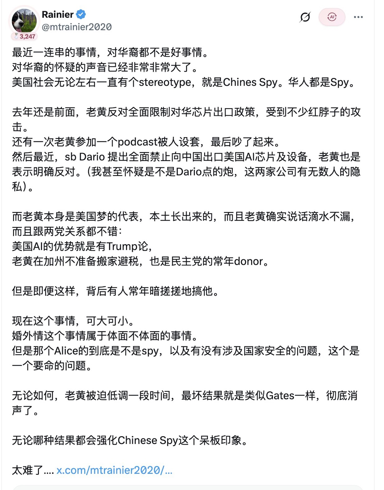
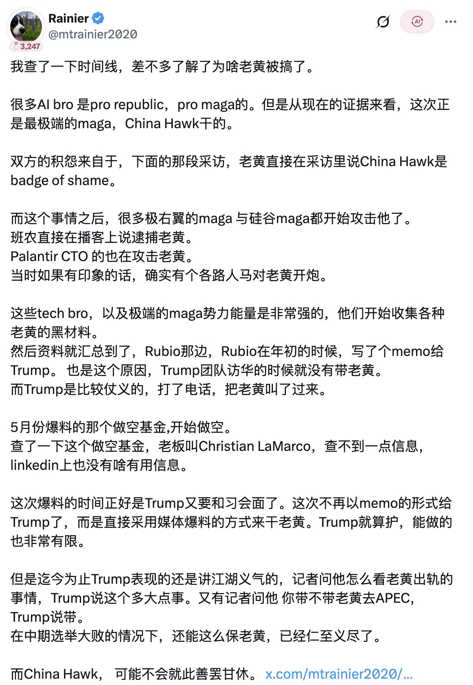

从一场硅谷政治风波，谈谈华人的身份困境、国家安全叙事与个人自由。

最近，黄仁勋身上的一连串风波让我产生了一种很复杂的感受。

最初看到相关消息时，我以为这不过是一次普通的商业人物丑闻。但随着更多报道出现，我逐渐意识到，这件事远远不只是一个企业家与某位女性之间的私人关系问题。

它牵扯到了美国两党政治、硅谷科技资本、中美科技竞争、情报机构，甚至一个更值得深思的问题：

一个出生于中国、拥有华人面孔、在美国取得巨大成功的人，究竟需要付出多大的代价，才能证明自己只是一个普通的美国公民和企业家？

我并不打算为黄仁勋的私人生活辩护，也不准备替任何商业利益站台。但这件事让我看到了某种令人不安的趋势：当国际政治越来越被安全与忠诚的叙事所支配，个人的身份似乎正在变成一种无法摆脱的政治标签。

⸻

## 一、黄仁勋究竟经历了什么？

先简单梳理一下事件。

黄仁勋是英伟达（NVIDIA）的创始人兼CEO，也是当今全球人工智能产业最有影响力的人物之一。

他出生于台湾，童年时期移居美国，后来在美国接受教育、创业并建立起全球最具影响力的半导体公司之一。

他长期反对美国对中国实施过于严厉的AI芯片出口限制。

他的核心观点并不难理解：

如果美国主动放弃中国这个庞大的市场，就等于主动把市场份额和产业影响力让给华为等竞争对手。与其把中国市场拱手相让，不如继续向中国销售符合出口规定的产品，让美国企业维持技术和商业优势。

这是一种典型的商业全球化思维。

但在华盛顿，这套逻辑并不总能得到认同。

以Anthropic CEO Dario Amodei为代表的部分科技界人士，以及美国对华鹰派，认为先进AI芯片具有重要的战略和军事价值，向中国出口这些产品可能削弱美国的技术优势。

于是，黄仁勋逐渐成为这场争论中的标志性人物。

事情的转折发生在有关Alice Huang的情报报道出现之后。

根据《纽约时报》等媒体的报道，美国情报人员怀疑Alice Huang与中国情报机构存在联系。她曾在新加坡企业Megaspeed任职，而该公司也因涉嫌协助受限制的英伟达芯片流入中国而受到调查。

报道还称，黄仁勋与Alice Huang存在亲密关系。

需要强调的是，这些涉及间谍活动的指控目前仍属于调查和媒体披露的情报判断，并不是已经经过公开司法程序证实的事实。Alice Huang也没有公开回应相关指控。

11月9日，路透社报道称，英伟达董事会已经启动调查，以了解黄仁勋是否成为外国情报行动的目标。特朗普则表示，黄仁勋告诉他自己并不知道对方涉嫌从事情报活动，并称自己相信黄仁勋。

这件事迅速从私人关系问题升级为国家安全问题。

而这也正是整个事件最值得关注的地方。

## 二、两张截图：真正值得关注的是美国政治内部的分裂

我看到的这两张X截图，来自用户Rainier。

作者试图从黄仁勋近期的遭遇中，梳理出一条更复杂的政治线索。

我认为其中有几个值得展开的部分。

<figure style="margin:1.5em 0;text-align:center">

<figcaption style="font-size:13px;color:#888;margin-top:8px">图1：X 用户 Rainier（@mtrainier2020）的帖子截图。作者指出，美国社会无论左派还是右派，长期都存在一种刻板印象——“Chinese Spy，华人都是间谍”；并提到 Dario Amodei 提出全面禁止向中国出口美国 AI 芯片，老黄明确反对；同时提到老黄是“美国梦的代表”，与两党关系都不错，背后却仍有人在针对他。</figcaption>
</figure>

### 1. 黄仁勋与China Hawk的矛盾

首先要解释一个词：China Hawk。

它通常指美国政治语境中的对华强硬派，也就是主张对中国采取更强硬政策、限制技术转让、强化军事和经济遏制的一类政治人物。

黄仁勋此前公开批评过这种思维，甚至将China Hawk称为一种不光彩的政治标签。

这自然会激怒一部分美国保守派人士。

尤其是在特朗普政治联盟内部，存在着相当复杂的利益分歧：

一方面，有强调美国制造业、科技产业和商业竞争力的科技资本派；另一方面，有将中国视为首要战略竞争对手、主张尽可能切断关键技术流动的国家安全鹰派。

这两派虽然都可能支持特朗普，但并不意味着他们在所有问题上意见一致。

黄仁勋显然更接近前者。

他希望美国企业继续参与全球市场，而不是通过全面经济隔离来解决竞争问题。

这并不意味着他支持中国政府的政治制度，也不意味着他认同中国的外交政策。

反对对华全面经济脱钩，与支持中国共产党，是完全不同的两件事。

这是我认为讨论这件事时必须坚持的基本区分。

### 2. Dario Amodei与硅谷科技圈的分歧

第二个值得关注的人物是Dario Amodei，也就是Anthropic的CEO。

他在AI芯片出口问题上的立场，与黄仁勋存在明显冲突。

Amodei更加重视先进芯片可能带来的国家安全风险，认为美国不应该轻易向中国提供关键算力资源。

而黄仁勋更强调市场竞争、技术生态和美国企业的全球影响力。

这实际上代表了两种不同的产业战略。

黄仁勋认为，美国应该通过商业竞争维持优势；Amodei则认为，在某些关键技术领域，国家安全应当优先于商业利益。

两种观点都不是毫无道理。

但我更关心的是：当两种商业和政策立场发生冲突时，究竟是谁有权决定美国科技产业的未来？

是企业家、国会、行政部门，还是情报机构？

这才是一个民主社会真正需要讨论的问题。

<figure style="margin:1.5em 0;text-align:center">

<figcaption style="font-size:13px;color:#888;margin-top:8px">图2：X 用户 Rainier（@mtrainier2020）的另一篇帖子截图。作者梳理时间线，推测极端 MAGA 与 China Hawk 势力收集老黄的黑材料、汇总到 Rubio 处，由 Rubio 年初写备忘录递交特朗普；并提到 5 月做空基金的爆料与此次媒体爆料的时机。</figcaption>
</figure>

### 3. 截图作者关于政治围攻的推测

第二张截图提出了一个更加复杂的判断：

黄仁勋此前与部分极端MAGA人士、硅谷右翼科技圈人士发生过公开冲突，随后有关Alice Huang的材料逐渐浮出水面，特朗普政府内部也曾经出现过相关备忘录。

作者怀疑，黄仁勋可能因此成为某些政治势力攻击的目标。

这里我认为必须保持谨慎。

目前能够确认的是，相关情报报道确实引发了英伟达董事会调查、国会议员质询以及美国两党对芯片出口政策的新一轮争论。

但这并不能证明Dario Amodei、Palantir的相关人士或者其他科技圈人物策划了针对黄仁勋的情报行动。

更不能仅凭时间上的先后关系，就认定有人故意向媒体泄露材料，以打击黄仁勋。

截图作者关于某些势力收集黑材料、利用媒体爆料的判断，属于政治推测，而不是已经证实的事实。

不过，这里面确实存在一个值得警惕的制度问题：

如果涉及国家安全的情报信息能够成为政治斗争的工具，那么无论被针对的人是谁，整个制度都应该接受监督。

国家安全不应该成为任何政治派别攻击商业竞争对手的万能理由。

## 三、我真正感到不安的，是Chinese Spy这个标签

如果说前面的内容主要涉及美国政治，那么接下来才是我最在意的部分。

截图第一张有一句话：

美国社会无论左派还是右派，长期都存在一种刻板印象：Chinese Spy，华人都是间谍。

这句话虽然有些绝对化，但它指出了一个真实存在的社会问题。

我们必须区分两件事情：

第一，美国有权调查真正涉及外国情报活动的个人和组织。

第二，不能因为某个人具有中国血统、华人面孔或者曾经在中国生活，就推定他与中国政府存在特殊关系。

这两者之间存在一道非常重要的界限。

国家安全调查需要具体证据、合法程序和明确的责任边界，而不是基于族裔背景的集体怀疑。

美国历史上并不缺少类似的教训。

二战期间，美国政府曾以国家安全为由，将大量日裔美国人强制迁移和拘禁。后来，美国政府正式承认这一政策存在严重的不公正。

这段历史说明，即使一个国家拥有宪法、法治和民主制度，也不意味着它永远不会在恐惧和战争情绪中犯下严重错误。

今天的中美科技竞争当然与二战时期的情况不同，不能简单类比。

但其中存在一个相似的危险：当国家安全成为社会最优先的政治议题时，某些人的个人权利可能会被轻易放到次要位置。

尤其是华人。

一个在美国出生长大、拥有美国国籍、对美国社会有深厚认同的华人，是否会因为自己的族裔背景而被要求额外证明忠诚？

一个从中国移民到美国、反对中国共产党、认同自由民主制度的人，是否就能因此完全摆脱这种怀疑？

恐怕未必。

这才是让我感到不舒服的地方。

我并不认为美国社会所有人都存在这种偏见，也不认为美国的制度已经失去了保护少数族裔的能力。

恰恰相反，我认为美国的法治传统、公民权利保障和独立媒体，仍然是纠正这类问题的重要力量。

但制度的价值，不应该只体现在顺风顺水的时候。

真正考验一个自由社会的，是它如何对待那些在政治气氛最紧张的时候，最容易成为怀疑对象的人。

## 四、一个让我感到矛盾的身份困境

说实话，我在看这件事情的时候，想到的并不只有黄仁勋。

我想到的是自己。

作为一个生活在中国的年轻人，我对自由、民主、法治和个人权利有着相当明确的认同。

我不认同威权主义，也不认为一个政府可以理所当然地要求个人服从它的政治叙事。

我希望有一天能够真正走出去，接触不同的文化，认识不同国家的人，在一个更加开放的社会中生活。

但黄仁勋的事情让我突然意识到，走出去可能并不意味着所有问题都会消失。

在中国，如果你公开表达一些与官方政治叙事不同的观点，你可能被某些人贴上崇洋媚外、立场有问题甚至汉奸的标签。

但如果你真的去了美国，成为一个在当地学习、工作和生活的华人，你又可能面对另一种身份审视。

你的出生地、语言、家庭关系、文化背景，甚至你与中国的普通商业联系，都可能被放进国家安全的讨论之中。

于是，一个很荒诞的问题出现了：

在这里，你可能因为不够认同中国而被怀疑；在那里，你又可能因为来自中国而被怀疑。

<figure style="margin:1.5em 0;text-align:center">

<figcaption style="font-size:13px;color:#888;margin-top:8px">插图（AI 生成示意图）：一个人站在两堵高墙之间，左侧是暖红色的墙，右侧是冷蓝色的墙——在两个世界之间，都可能因为身份而被怀疑。</figcaption>
</figure>

当然，我并不想把所有美国人都想象成排斥华人的人，更不想把个别政治事件扩大成整个社会的态度。

美国仍然有大量华人科学家、企业家、教授和普通公民，他们在社会中拥有自己的生活和权利。

但我越来越不愿意相信一种过于简单的叙事：只要离开中国，就自然能够获得身份认同和精神上的归属。

现实显然比这复杂。

我希望自己将来能够在美国或者其他自由社会生活，不是为了成为某个国家的政治工具，也不是为了证明自己比其他中国人更加优秀。

我只是希望，自己能够拥有选择生活方式的权利。

我可以出生在中国，但不必对中国政府的每一项政策负责。

我可以拥有华人血统，但不必因此向任何国家证明自己的政治立场。

我可以批评中国政府，也可以批评美国政府。

我可以支持美国的自由民主制度，同时对美国的种族偏见、政治极化和政府权力保持警惕。

这不应该是一种矛盾。

这恰恰是自由主义最基本的精神之一：个人不是国家的附属品。

## 五、不要把美国理想化，也不要放弃对自由的追求

我一直认为，评价一个国家，不能只看它的经济规模、军事力量和国际影响力。

更重要的是，它如何对待具体的人。

一个国家是否允许个人批评政府？

是否允许媒体调查权力？

是否允许司法机关独立审查行政部门的行为？

一个人的权利，是否会因为他的族裔、出生地和政治观点而发生变化？

这些才是我真正关心的问题。

我支持美国的自由民主制度，并不意味着我认为美国政府永远正确。

特朗普政府的对华政策可以接受国会监督，情报机构的行为可以接受法律审查，企业与外国人员的关系可以依法调查。

但所有这些权力都必须有边界。

如果一个人涉嫌间谍活动，就拿出证据，按照法律程序调查。

如果一家企业涉嫌违反出口管制，就调查企业的具体行为。

如果有人利用商业关系转移敏感技术，就追究相关人员的责任。

但不能因为某个人姓黄、姓李，或者拥有华人面孔，就默认他与中国政府存在某种不可告人的联系。

我不希望美国变成一个需要不断进行政治忠诚测试的社会。

同样，我也不希望中国继续以国家利益、民族主义和政治忠诚为理由，要求每一个普通人接受统一的思想和身份定义。

一个真正自由的社会，应当允许一个人不必时刻解释自己是谁、忠于谁、代表谁。

⸻

## 写在最后

黄仁勋可能最终会被证明没有参与任何情报活动，也可能在调查中暴露出一些值得追究的问题。

这两种结果都不能预先排除。

如果他确实存在违反法律的行为，那么他应该承担相应责任。商业成就、个人财富和与总统的关系，都不应该成为法律豁免权。

但如果他只是因为与一名受到怀疑的人存在私人关系，就被无限放大为国家安全威胁，那么同样值得警惕。

我不希望看到任何一个人因为自己的华人身份，就被预先归入某个国家的政治阵营。

更不希望有一天，所谓的忠诚变成衡量一个人是否值得被尊重的前提。

我出生在中国，但我不属于任何政府。我认同自由民主，但我不需要对任何国家无条件效忠。我希望自己将来生活在一个可以自由表达、自由选择、依法保护个人权利的社会。

我想要的从来不是从一个国家的政治叙事，逃进另一个国家的政治叙事。

我想要的，只是作为一个独立的个人生活的权利。

而这，或许才是这件事情带给我最深的思考。

文章涉及的事实背景，可以参考以下报道：

- Reuters：[Trump's close ties to Nvidia's Huang scrutinized after foreign intelligence concerns](https://www.reuters.com/world/asia-pacific/trumps-close-ties-nvidias-huang-scrutinized-after-foreign-intelligence-concerns-2026-11-09/)（2026 年 11 月 9 日）——关于英伟达董事会调查、特朗普回应及国会质询。
- The Washington Post：How Nvidia's CEO Jensen Huang gained darling status in Trump's orbit（2025 年 10 月 29 日）——黄仁勋与特朗普阵营的关系，以及他与对华鹰派的政策分歧。
