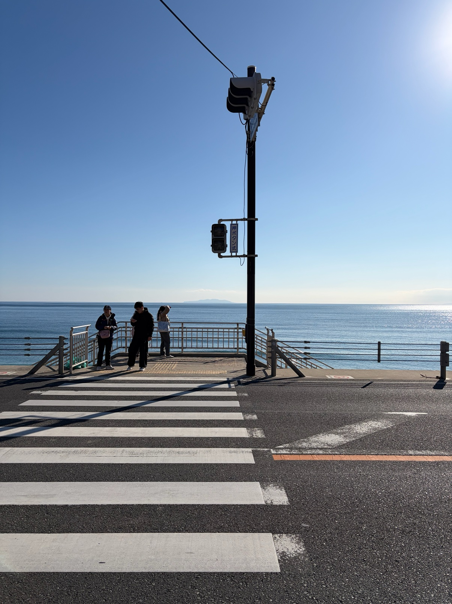
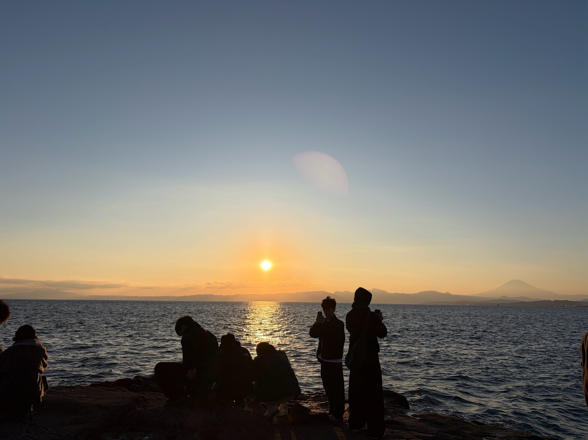
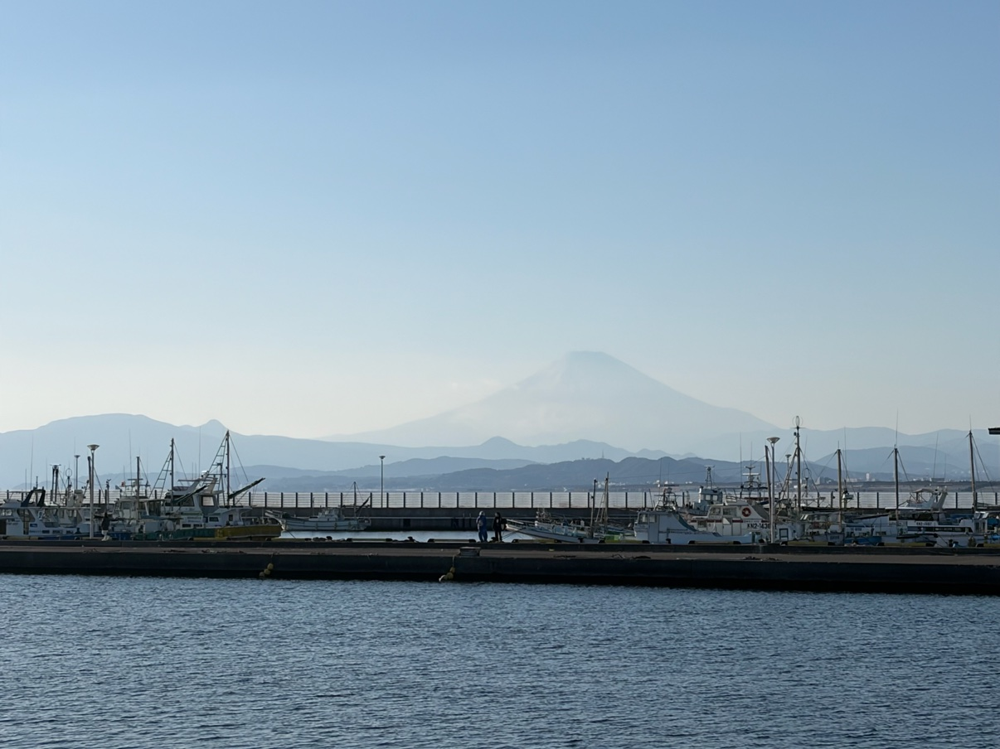

这段时间，我把《青春猪头少年不会梦到兔女郎学姐》又看了一遍。

第一次点开它还是上初中，只觉得这名字怪得很——青春猪头少年，兔女郎学姐，像谁随手拼出来的。年纪小，也没看出什么特别，热闹看完就完了。

这次重看，看懂的是另一件东西：青春期综合症。那些说不出口的心事，那些被周围的气氛推着走、明明不愿意却不敢出声的瞬间，被这部动漫一件一件摆了出来。而我越看越觉得，我的故事，得从 2026 年年初的那趟日本之行讲起。

## 第一次看见大海

2026 年年初，我只身一个人飞去了日本。

去的理由，一半是想亲眼看看一个民主政治的社会到底是什么样子，另一半，是想在一个没人认识我的地方，替未来的自己做一次选择。

我独自走在镰仓的海边。那是我人生中第一次看见大海。长在内陆的人，对海的全部想象都来自屏幕：课本里的波澜壮阔，视频里的浪花和日落。真站到相模湾边上，海风一吹，才知道一望无际不是形容词，是压过来的。

## 江之岛的夕阳，和一个不知名的同乡

江之岛的夕阳很美，我想找人帮我拍张照片。

环顾四周，我看见一个人拿着华为手机。在异国他乡，这大概是最可靠的同乡探测器了。我上前询问，果然是中国人。

他是河南人，在西安交通大学读土木。他说，他也是一个人飞到日本的，原因特别简单：喜欢樱岛麻衣，想来看看咲太和麻衣生活的地方，追一追自己喜欢的东西。

两个互不知姓名的中国年轻人，因为一部动漫，在异国的海边替对方按下快门，然后各自散进人海。我至今不知道他的名字。但那天夕阳落在富士山边上的样子，我记得很清楚。

## 二月六日，大阪

2月6号我在大阪京坂本线换乘大阪环状线，去酒店存放行李。由于看不懂换乘规则，我用唯一会的几句日语和蹩脚的英语问一旁的高中生，她很热情的用英语告诉我和她是同一路线，我狼狈的跟在她后面逆着人流的方向。

她问我来自哪里，我英语混杂日语说China，去关西空港。给她看了在mt.fuji下的照片，她说她没有离开过大阪，富士山很漂亮。有些复杂的交流要用我手机的翻译软件，她也是iPhone，自动共享了名片。送我到检票口之后我们挥手告别，她没有进大阪环状线，我用日语和她讲了再见。

回国之后发现因为换卡的原因她的名片丢失了，我们再也没有机会能联系上，有些哀伤，iMessage里她发给我了一张附带我进闸机之后照片的简讯，可我的后续的消息再也无法发出了。

## 按部就班

回国之后，我又点开了《兔女郎学姐》。

这一次我才算看明白：动漫里的人物，是可以为了自己的人生而活的。可以选择自己想爱的人，可以为了属于自己的未来，不管不顾地往前走。

现实里的日本高中生也是这样。下午很早就放学了，在鹤冈八幡宫和镰仓大佛前摄影留念，去追求自己的东西。他们的时间，是他们自己的。

而我们呢？

我们中国人，千千万万个，流水线一样被批量生产出来的我们，没有自己的选择。高中，大学，就业，结婚——人生的每一站都提前印好了时刻表，你只需要在正确的时间，出现在正确的站台上。没有人问你想去哪里，因为路线早就替你定好了。

## 二十岁，还没好

可能我这些想法，也只是青春期综合症的一种吧。

但我已经 20 岁了，早就过了青春期。只是我缺失的那一部分——为自己做一次选择，为自己喜欢的人和事活一次——不会随着年龄自己长回来。它可能要用一生来治愈。

这也是我为什么如此坚定地想要去美国，想要把命运抓在自己的手里。

镰仓的海还在涨潮。我的青春期来晚了，但它总算来了。
