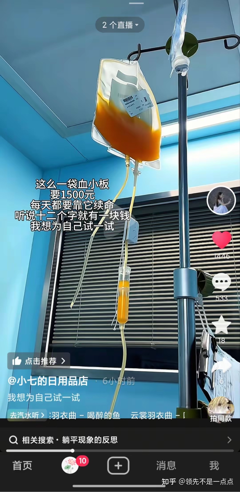

感冒发烧花不了多少钱，但一场大病，足以让一个家庭破产。社交平台上，因病致贫、被迫放弃治疗的求助信息随处可见。

## 没有自付封顶的医保

中国的医保制度里，没有个人自付封顶——也就是说，一个病人一年自己要掏多少钱，是没有上限的。

相比之下，美国医保的自付封顶约为 9000 美元，日本约为 53 万日元。这两个数字，大约相当于当地普通工薪阶层 2 到 3 个月的工资。封顶之外的费用，由医保承担。

没有封顶，意味着药价可以直接击穿一个家庭的承受能力。下图中的药，达妥昔单抗β注射液，原价 59500 元一瓶，纳入医保后 6000 元一瓶，半年的费用仍然需要 15 万元。

## 进了医保目录，不等于能报销

人血白蛋白是癌症治疗中的常用药，约 750 元一瓶，一天一瓶，一个月超过 2 万元。

同一种药，在不同的医保类型下待遇完全不同：公费医疗可以覆盖，而职工医保并不报销。

医保目录内的药物也不代表就能报销。人血白蛋白属于乙类药，按规定职工医保的报销比例可达 90%，但在实际使用中，癌症患者的人血白蛋白费用往往需要自费。

## 靶向药：一个月 10 万

以靶向药贝伐单抗、爱必妥为例，一个月的费用在 10 万元左右。

现在，这两种药有了仿制药，也进了医保目录。但进了目录不等于能报销：胃癌不在适应症范围内，仍然不予报销。如果按现价治疗，吃便宜的仿制药半年需要 11 万元，原研药则需要 16 万元。

## 有退休金、有存款，也扛不住

即便是有退休金、有存款，还有单位补充商业保险的家庭，面对每月数万元的药费，同样难以承受，只能缩减用药。

而对于每月只有 200 元退休金的农民家庭，遇到癌症几乎没有承受能力。新农合的报销比例远低于职工医保，保障差距更大。

## 罕见病：终身用药，一个月 10 万

罕见病患者的处境更为极端。以庞贝病为例，需要终身用药，一个月的药费高达 10 万元。医保报销之后，仍然是普通家庭无法承受的数字。

一场大病，先掏空的是积蓄，再掏空的是一个家庭的未来。而医保没有自付封顶，意味着这道口子没有底线。
