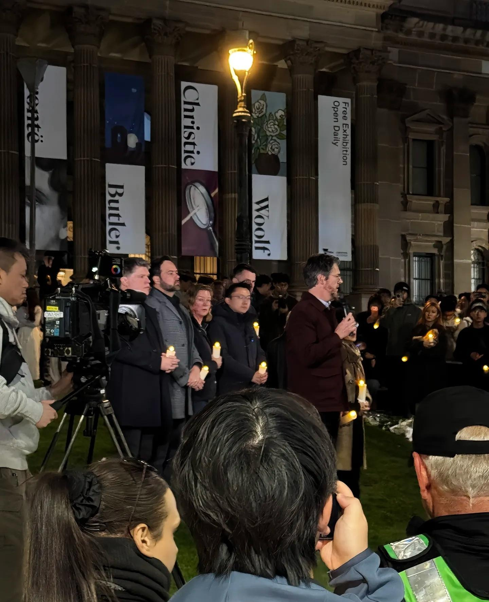
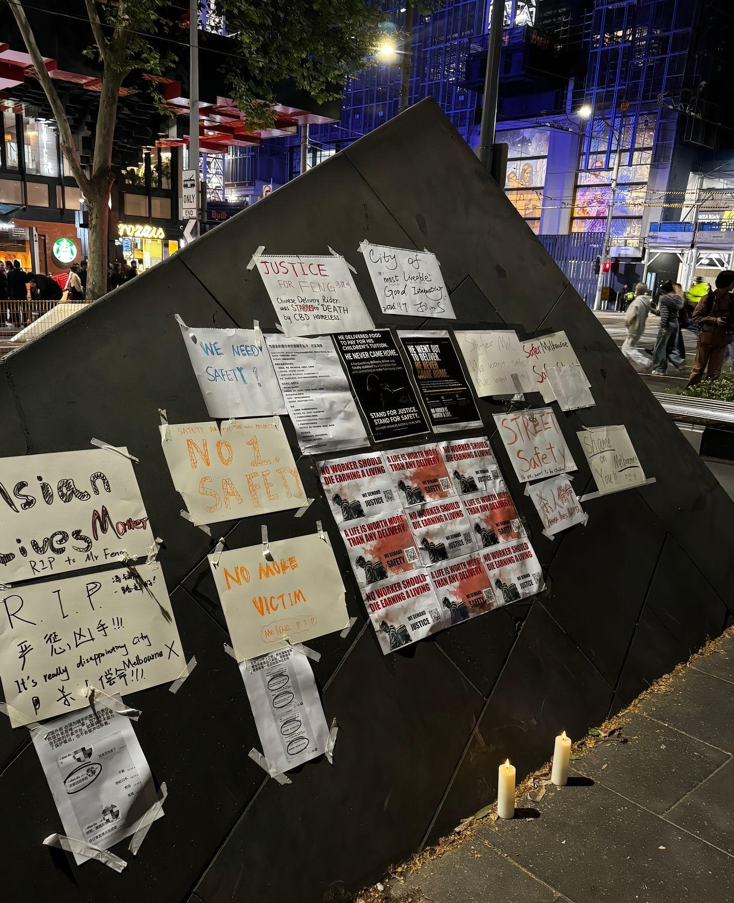
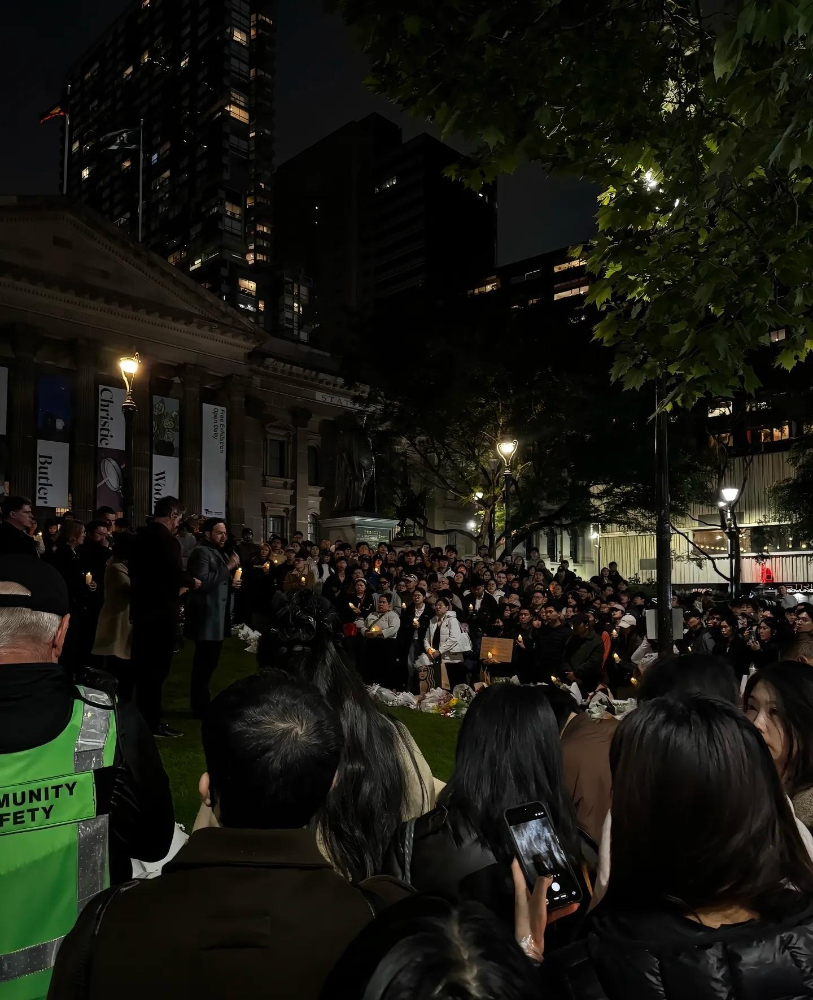
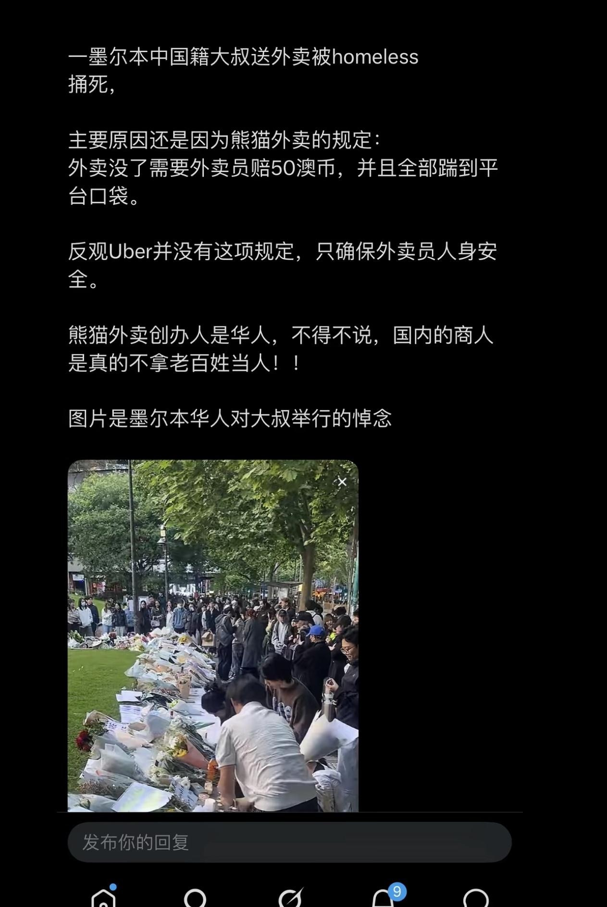

澳大利亚一个中国外卖员不幸被流浪汉刺死，整座城市都为他静默，整个澳大利亚都为其肃穆，当地名人自发前来为他默哀发言，并且保证抚恤金会很快打给他的家人。

一个身处海外的中国人民，被整座城市悼念，被所有人铭记于心，当地名人表示一定会为他讨回公道。

一个默默无闻只知道奉献干活的人，在他死的那天被一座城市所怀念。

每一个人都是可以被世界铭记的，无论等级高低，无论职业大小，无论高矮胖瘦。

美国国家公墓上可以做到纪念每一个为国家而死去的公民，每一个名字不分等级高低贵贱，那些默默无言早被家乡遗忘的华人劳工被世界铭记着，英国华工纪念馆里面密密麻麻的写满了每一个在这里工作过的华工名字，那些默默无闻的华工在英国年年被当作英雄纪念着，每一个有名字的都被当成英雄，

而澳大利亚也毫不逊色

它最盛大的舞台纪念着一位非凡的普通人，他很平凡，他很普通，他也很卑微，卑微到为了不被平台五十澳元惩罚而选择不顾一切保护外卖而战，直到被流氓刺死，也许像无数个默默无闻的人一样就这么冰冷死去，也许像一个又一个沉寂而消失的数据一样。

或许千千万万的他早已经被世人所漠视，但是他终究不会被世界所遗忘，他虽然只是一个平凡的中国人，他是千千万万个父亲，家庭的代表，这个世界因为无数个他而繁荣昌盛，所以他更是一个英雄，一个值得被所有人铭记的中国英雄，一个为了生存而战的中国英雄，一个为了保护自己家庭而战的中国人！

感谢这座温暖的城市，愿意为这个中国人挺身而出！愿意还他这个公道

愿意让我们相信从某千古一帝开始之后，人民只能被当作基础数据报废掉的命运在此刻被终止，在此刻每一个人终将拥有自己的名字，也将和世界上所有热爱生活热爱生命，为了世界而活的人一样，留下一个非凡的名字。
