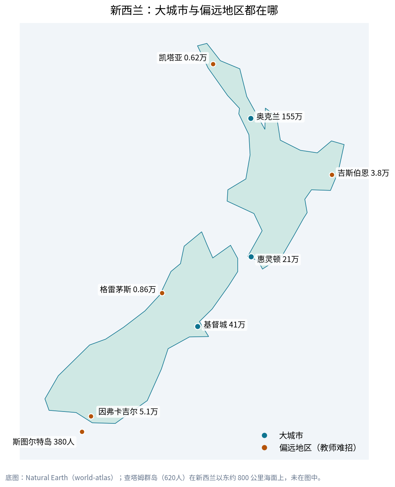
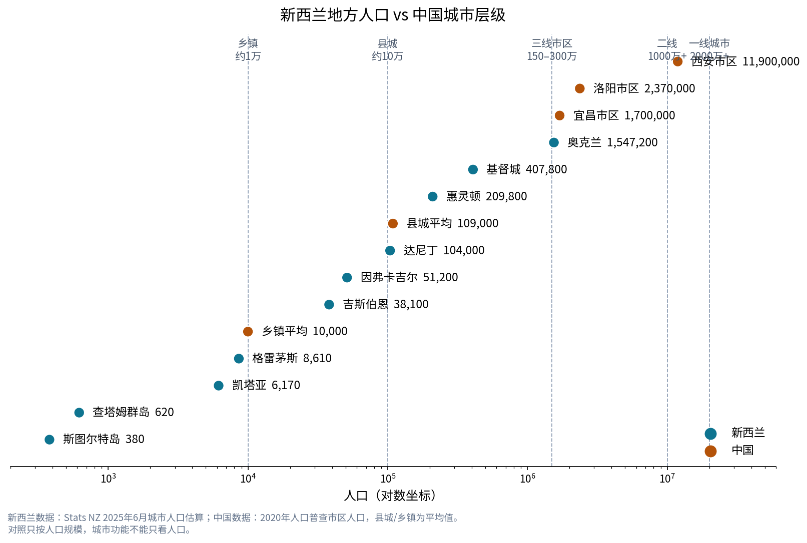

新西兰移民，现在是什么情况？走留学 → 工签 → 居民签这条路，还行得通吗？

这篇是个参考，不是结论。里面的政策数字，我都拿新西兰移民局、教师协会、NZQA、教育部这些官方来源逐条核对过。优点、缺点、风险都列出来，判断留给你自己做。政策时效以 2026 年 11 月 26 日为准，移民政策变得快，出发前务必再去官网复核一遍。

## 这条路是怎么走的

先说路线。最常见的走法是：去新西兰读一个硕士，毕业拿 Post Study Work Visa（毕业工签，硕士最长 3 年），找到认证雇主（accredited employer）的工作，申工签留下来，再通过技术移民（Skilled Migrant Category，6 分制）或绿名单拿居民签。

其中一条分支是当中学老师。教师这条路单独拿出来说，是因为它的门槛和回报都很特殊，下面会细讲。

## 岗位缺口：2026–2030（存量–流量模型测算）

先说最关键的：缺口有多大，还能缺几年。

教育部《教师供需预测 2025》（2026 年 2 月发布）只预测到 2028 年。中学教师缺口（中等情景，最可能的情况）：2026 年约 710 人，2027 年约 510 人，2028 年约 190 人。小学同期是过剩：2026 年多出 530 人，2028 年多出 1,350 人。

**2029 年、2030 年没有官方数字。** 下面是我用存量–流量模型自己算的，公式、参数、数据来源全部列出来，可以复核。

**模型：**

供给（下一年）＝ 供给（当年）－ 流出 ＋ 流入

流出 ＝ 退休 ＋ 去海外（含澳洲）＋ 其他离职

流入 ＝ 回流教师 ＋ 本地新毕业教师 ＋ 海外招聘教师 ＋ 政府项目

**校准（2026–2028 年，教育部中等情景）：**

需求 30,650 → 30,650 → 30,520；供给 29,940 → 30,140 → 30,330；缺口 −710 → −510 → −190。

教育部数据：中学教师留存率 90.5%（2026 年预测），即每年流出约 9.5%，约 2,860 人；流入约 3,050 人（已扣掉新入职第一年就走的人），供给每年净增约 200 人。

**2029–2030 年的流出端，两个关键变量：**

**1. 退休。** 中学教师平均年龄 46.0 岁，30% 在 55 岁以上（约 9,200 人），6.1% 在 65 岁以上。按 PPTA 2025 年调查，退休占离职原因的 27%，约 780 人/年。随着 55 岁以上这批人陆续进入 60–65 岁，退休人数每年增加约 25 人：2029 年约 805 人，2030 年约 830 人。

**2. 去澳洲。** 新西兰教师去澳洲没有官方统计。能拿到的硬数字：PPTA 调查里 19% 的离职是“去海外”，约 550 人/年，其中澳洲占大头（单是维多利亚州，截至 2023 年 6 月的 12 个月里就接收了几百名新西兰教师）；2025 年新西兰公民净流失去澳洲 28,500 人。驱动力是工资：新南威尔士州中学教师起薪约 10.4 万纽币，比新西兰起薪（6.1 万纽币）高约 69%。模型里按去澳洲约 385 人/年、每年增加约 20 人算：2029 年约 405 人，2030 年约 425 人。

本地人口往澳洲流出这个因素，在需求端也已经算进去了：教育部学生人数预测（NSRP）用的就是包含净移民假设的学龄人口数据，学龄净移民 2025 年约 11,100 人、2026 年约 10,200 人，到 2030 年约 12,300 人，抵不掉出生人数下滑带来的学生减少。所以需求端每年减少约 135 名教师（学生每年减少约 1,300–1,500 人，按约 1:10.4 的师生比折算）。

**流入端：** 本地教师教育毕业生在涨（2025 年首次入学人数比 2024 年涨 26%，毕业人数 785 → 890），2029、2030 年每年多进约 85–120 人；海外招聘在涨（2025 年已有 496 名中学教师抵达，比 2024 年全年的 446 人多），每年多进约 30–40 人；回流教师约 2,310 人/年，基本稳定；政府项目按中等情景 800 人/年。

**测算结果（数字四舍五入到十位）：**

| 年份 | 需求 | 供给 | 缺口 |
| 2026 | 30,650 | 29,940 | −710（官方） |
| 2027 | 30,650 | 30,140 | −510（官方） |
| 2028 | 30,520 | 30,330 | −190（官方） |
| 2029 | 约 30,380 | 约 30,620 | 约 +240（模型） |
| 2030 | 约 30,250 | 约 30,960 | 约 +710（模型） |

**结论：2029 年前后，中学教师整体缺口基本消失，转为小幅过剩；2030 年过剩约 700 人。** 退休和去澳洲这两项，每年一共多带走约 45 人，只把缺口消失的时间往后推了两三个月，没有改变方向。真正让缺口消失的，是需求端（学生人数见顶回落）和供给端（教师教育毕业生和海外招聘在涨）同时发力。

**小幅过剩是什么意思？先说结论：不是找不到工作，但找工作的难度会上去。**

- 过剩很小：+240 人是总数的 0.8%，+710 人是 2.3%，也就是每 100 个中学教师岗位里多出不到 1 到 2 个人。跟现在缺 710 人比，是供需翻过来了，但不是岗位消失。
- 每年都有约 2,900 个空缺：教师每年流出约 9.5%，退休、去澳洲、转行都要有人补。哪怕总数过剩，替换需求一直都在，工作一直都有。
- 缺的科目还在缺：数理、毛利语、偏远地区学校的缺口不会跟着总数消失。教育部报告里明确说了，数理等科目的短缺不能被其他科目的过剩抵消。PPTA 调查里 1/5 的空缺招不到人，数学最难招。
- 对新人来说，竞争会变难：学校不缺人的时候，会先挑有本地经验、有实习关系的老师。海外来的新老师，没有新西兰课堂经验，找第一份工作会比现在难。
- 所以：工作还是能找，但要挑对科目（数理）、去难招人的地区和学校、靠实习积累本地关系，窗口期在 2029 年之前。

**敏感性：** 模型对留存率最敏感。如果留存率回落到 2024 年的 88.5%，2029 年缺口仍在 −300 上下；如果澳洲流出每年多 50 人、退休每年多 40 人、政府项目按低情景（每年 675 人），2029 年缺口约 +100，2030 年约 +400——方向不变，只是过剩来得慢一点。教育部自己的情景区间也很大（2028 年缺口从 −1,480 到 +1,180），关键看政府项目资金续不续、留存率稳不稳。

但整体平衡不等于人人有岗。数理（科学、技术、数学）、毛利语教学、偏远地区和最难招人的学校，缺口会持续更久。教育部报告里明确说了，数理等科目的短缺不能被其他科目的过剩抵消。教师工会 PPTA 2026 年第一学期调查（155 位校长）：23% 的空缺没有任何合适申请人，28% 只有一个，1/5 的空缺招不到人，数学是最难招的科目之一。科目缺口比总数缺口活得久。

## 偏远地区到底有多偏远？

先说一个前提：新西兰全国只有约 530 万人，奥克兰 155 万是全国最大的城市。按人口算，新西兰根本没有一线、二线城市——奥克兰的人口规模，大概相当于国内一个三线城市的市区（宜昌市区约 170 万、洛阳市区约 237 万；三线城市比如洛阳、宜昌、柳州、赣州）。所以“偏远”在新西兰不是“离市中心远”，而是“镇上就几千人、最近的大医院要开几小时车”。

**先对一下层级（按市区人口）：**

| 新西兰地方 | 人口 | 对标国内 |
| 奥克兰 | 155 万 | 三线城市市区（宜昌 170 万、洛阳 237 万之间） |
| 基督城 | 41 万 | 四线城市 |
| 惠灵顿 | 21 万（功能区 44 万） | 四线城市 |
| 汉密尔顿 19 万、陶朗加 16 万、达尼丁 10 万 | 10–19 万 | 县级市 |
| 因弗卡吉尔 5.1 万、旺格雷 5.6 万、罗托鲁瓦 5.9 万 | 5–6 万 | 县城 |
| 吉斯伯恩 3.8 万 | 3.8 万 | 县城 |
| 格雷茅斯 0.86 万、凯塔亚 0.62 万、韦斯特波特 0.46 万 | 不到 1 万 | 乡镇，一条街 |
| 查塔姆群岛 620 人、斯图尔特岛 380 人 | 几百人 | 村 |

对照只按人口规模，城市功能不能只看人口——奥克兰有国际机场、大学和全国总部，但地铁、高铁、大商场的规模跟同等人口的中国城市没法比。

**再看三个具体地方，医疗、交通、购物一项一项来：**

**格雷茅斯（西海岸，8,610 人）**
- 医疗：Grey Base 医院是整个西海岸唯一的急诊；大病直升机送基督城。开车去基督城 241 公里，约 3 小时。
- 交通：最近的机场在霍基蒂卡，每天两班飞基督城（40–45 分钟）；韦斯特波特 2026 年 5 月 1 日后一度没有定期航班，12 月 4 日起恢复每周两班（周一、周五）。
- 购物：New World + Woolworths 两家超市，没有 Pak'nSave，没有商场。

**凯塔亚（远北，6,170 人）**
- 医疗：28 张床的小医院，服务约 2.1 万人；重病送旺格雷（约 150 公里、约 2 小时车程）或直升机送奥克兰。
- 交通：Barrier Air 每天飞奥克兰（50–60 分钟），开车去奥克兰 4.5–5 小时。
- 购物：全镇一家超市 PAK'nSAVE——1985 年新西兰第一家 PAK'nSAVE 就开在这里。

**吉斯伯恩（3.8 万人）**
- 医疗：110 张床的二级医院，24 小时急诊。
- 交通：开车去纳皮尔约 3 小时、去汉密尔顿约 5 小时（374 公里）；飞机到奥克兰约 1 小时、到惠灵顿 1–1.5 小时。
- 购物：PAK'nSAVE + Woolworths，没有 New World，没有大商场。

**极端情况：** 查塔姆群岛 620 人，岛上有医生诊所，重病空运；一周只有几班飞机，没有客轮，只有一家主商店。斯图尔特岛 380 人，护士诊所每天上午 10 点到 12 点半开，医生两个月来一次；坐 20 分钟小飞机或 1 小时渡轮去因弗卡吉尔；一家 Four Square 超市。

**这跟教师缺岗有什么关系？** 2028 年地区缺口最严重的是奥塔哥（−6.9%）、奥克兰南区（−5.2%）、奥克兰北区/西区（−4.8%）、北地（−2.5%）。注意：西海岸在地区模型里 2028 年反而是小幅过剩（0 到 +10 人）——地区总数不代表每所学校，教育部自己也说了，个别难招的学校模型里看不出来。新西兰有个“隔离指数”（isolation index），达到 1.27 以上的学校拿专项拨款；去偏远学校还有补贴：海外搬迁补助最高 1 万纽币、教师绑定计划 5 年最高 4 万纽币（每年 185 个名额）、偏远学校津贴每年 1,000 纽币。

## 优点

**1. 中学教师在绿名单 Tier 1，可以直接申请居民签。**

中学教师（ANZSCO 241411）在绿名单 Tier 1，走 Straight to Residence，不用排队等抽签。条件：教师协会注册 + provisional 或 full 执业证书 + 认证雇主 + 12 个月以上工作 + 时薪不低于 35 纽币。

**2. 毕业工签窗口相对宽。**

硕士毕业、在新西兰全日制读满 30 周以上，毕业工签最长给 3 年。比起很多国家毕业就走人，这个缓冲期算宽的。

**3. 认证雇主工签的中位工资门槛取消了。**

2025 年 3 月 10 日起，AEWV 取消了中位工资要求，改为市场工资 + 最低工资。要求：认证雇主 + 岗位审核通过，每周至少 30 小时，2 年相关工作经验或 4 级以上学历（本科任何专业都算）。

**4. 2026 年的几项改革，通道没有全关死。**

2026 年 8 月 24 日技术移民大改，改为三条通道，新西兰学历加分，工作经验加分更快。2026 年 11 月 23 日起毕业工签放宽，新增 6 个月短期毕业生工签，7 级 GradDip + 本科也可申毕业工签（最长 1 年）。

## 缺点

**1. 语言门槛是硬的：雅思每项 7.0。**

教师协会现行政策（2026 年 1 月 21 日起）：雅思学术类每项 7.0、总分 7.0，两年内有效，接受单项重考。其他选择：PTE、剑桥、托福等也有对应分数。7.0 每项对大多数人来说依然是硬门槛。

**2. 海外学历不能直接注册当老师，必须重读一个教师教育项目。**

NZQA 的教师学历认证（Teaching IQA）只认“专门为培养教师而设”的学历，海外普通本科学历不在此列。想当老师，必须先在新西兰读完 Graduate Diploma of Teaching（中学方向，1 年）或 Master of Teaching and Learning（中学方向，11 个月）。这是一年的学费 + 生活费 + 时间成本。

**3. 教学科目要修到 300-level，能不能算要逐案评估。**

GradDip（中学）入学要求本科学历，且教学科目要修到 300-level（大三程度），最好第二科目到 200-level，还要面试、读写算测试、无犯罪记录。Master of Teaching and Learning（惠灵顿维多利亚大学）要求 GPA 5.0（B 均分），每年只有 30 个名额，要去惠灵顿参加选拔日。本科的数学、物理内容能不能算作教学科目，官方没有统一答案，只能交成绩单逐案评估。

**4. 找工作是最大的坎。**

找不到认证雇主，毕业工签过期只能回国。岗位缺人是事实，但门槛把大多数人挡在外面。缺的是“符合全部条件的人”，不是“想当老师的人”。

**5. 绿名单不是毕业就能上。**

移民局自己提醒：教学岗位可能达不到薪资要求，刚毕业的新老师不太可能立刻符合条件。技术移民里注册教师的 5 分，要“注册 + Full 1 或 Full 2 执业证书”，刚毕业拿的是 provisional（初级）证书，不算这 5 分。也就是说，注册这条路要工作几年、升到 Full 证书才加得上分。

**6. 课堂管理是另一道门槛。**

语言分够了只是入场券，课堂管理、和当地学生的沟通，是另一套本事。

## 风险

**1. 政策本身在变，而且变得快。**

ACT 党提案就是例子：ACT 在 2026 年 9 月 1 日提出取消永久居民签证（PRV）、把居民签旅行权限改为 5 年、要求滚动 5 年内住满 730 天。但 10 月 26 日 ACT 在竞选纲领里已经撤回了取消 PRV 的部分，只保留“5 年住满 2 年”的要求。目前这只是政党政策，不是联合政府政策，更不是法律。2026 年 11 月 7 日大选初步结果：国家党 42 席、ACT 13 席、优先党 12 席，共 67/131 席；官方结果定于 11 月 27 日公布。政策方向要等官方结果出来再看。

**2. 大趋势是“更挑”，不是“不收”。**

未来 10–20 年，移民政策的关键词不是“少”，而是“更挑”。OECD《国际移民展望 2025》（2025 年 11 月 3 日）：2024 年 OECD 国家接收约 620 万永久移民，比 2019 年高约 15%，但比疫情后高峰回落 4%。世界银行《全球经济展望》（2025 年 6 月）：如果预测成真，2020 年代前七年的平均全球增速将是 1960 年代以来任何十年中最慢的——注意这是有条件表述，不是既成事实。

低增长、AI 替代部分岗位、国家安全逻辑回归，三个因素叠加，普通低技能岗位入口会越来越窄，标准化白领岗位的移民价值可能下降。医生、护士、工程师、真正掌握稀缺技术的高级技师、AI 人才，政策价值越来越高。国家开始像挑资产一样挑移民。

**3. 身份的稳定性，不再是默认项。**

1990 年到 2015 年前后，公民、永久居民、长期居民在日常生活中的实际差距越来越小，公民身份越来越像“护照加投票权”。但如果未来世界越来越强调地缘政治竞争、产业政策、技术管制、金融制裁、关键基础设施安全，那么公民和居民之间的权利差距很可能重新扩大。

历史上有过先例：两次世界大战期间，英国、澳大利亚、新西兰、加拿大都实行过针对所谓“敌国侨民”（enemy aliens）的登记、限制旅行、拘禁；加拿大 1942 年强制迁移了超过两万名日裔居民，今天加拿大政府也承认当时缺乏充分证据。这不是说历史一定会重复，而是说：外国居民权利的稳定程度，很大程度上取决于整个国际秩序。PR 拿到手，不再像 1995 年或 2005 年那样，可以默认“基本永久稳定”。

**4. 投入大、周期长，别梭哈。**

按年算：1 年教师项目 + 找工作 + 攒工作经验升 Full 证书，不是毕业就拿居民签。学费、生活费、时间成本都要算进去。不管怎么选，难度都很高，请谨慎规范，不要梭哈。

## 政策变化预估

下面是我根据现有信息做的预估，不是官方消息：

- 大选官方结果 11 月 27 日公布，联合政府组建后，ACT 的“5 年住满 2 年”要求可能进入立法程序；PRV 取消已经撤回，短期内不用担心 PR 本身被取消，但未来居民签的旅行权限、居住要求有收紧的可能。
- 绿名单 2027 年 3 月 8 日调整生效，中学教师不受影响；下一轮绿名单评估（大概率 2027 年内）可能继续收窄 Tier 2，教师 Tier 1 的地位短期内大概率不变——因为缺口还在。
- 技术移民 6 分制 2026 年 8 月刚大改，短期内再大动的可能性低；但时薪门槛（35 纽币/小时）每年随中位工资调整，2027 年大概率上调。
- 毕业工签放宽 2026 年 11 月 23 日刚生效，短期内是窗口期。
- 模型显示 2029 年前后中学教师整体缺口基本消失，意味着教师这条路的政策红利窗口可能在 2029 年前后收窄——不是说 2029 年之后就走不通，而是“缺人”这个最大的政策理由会变弱。

## 关键数字速查

- 教师注册语言：雅思学术类每项 7.0、总分 7.0（2026 年 1 月 21 日起政策）
- 毕业工签：硕士读满 30 周，最长 3 年
- 技术移民：新西兰硕士 6 分；海外硕士 + 本科 5 分；博士 6 分
- 技术雇佣时薪：至少 35 纽币（ANZSCO 1–3 类）；中位工资 35 纽币/小时（2026 年 3 月 9 日起）
- 教师注册分：5 分，需 Full 1/Full 2 执业证书，provisional 不算
- 中学教师缺口：2026 年约 710 人，2027 年约 510 人，2028 年约 190 人（官方）；2029 年约 +240，2030 年约 +710（模型测算，转为小幅过剩）
- OECD 2024 年永久移民：约 620 万，比 2019 年高 15%，比疫情高峰回落 4%

## 近期政策变化（2026 年）

- 2026 年 8 月 24 日：技术移民大改，改为三条通道；新西兰学历加分，工作经验加分更快。
- 2026 年 11 月 23 日起：毕业工签放宽，新增 6 个月短期毕业生工签；7 级 GradDip + 本科也可申毕业工签（最长 1 年）。
- 2026 年 11 月 3 日宣布、2027 年 3 月 8 日生效：绿名单调整，17 个 Tier 2 职业移出，4 个特殊教育教师从 Tier 2 升到 Tier 1；中学教师不受影响。

## 来源

- 新西兰教师协会：海外教师注册、语言要求 https://teachingcouncil.nz/en/become-a-teacher/overseas-trained-teacher-coming-to-Aotearoa/register-to-teach-as-an-overseas-teacher
- NZQA：教师学历认证 https://www2.nzqa.govt.nz/international/recognise-overseas-qual/iqa/for-teachers/
- 新西兰移民局：毕业工签、认证雇主工签、技术移民、绿名单 https://www.immigration.govt.nz/visas/post-study-work-visa/ https://www.immigration.govt.nz/visas/accredited-employer-work-visa/ https://www.immigration.govt.nz/visas/skilled-migrant-category-resident-visa/ https://www.immigration.govt.nz/visas/straight-to-residence-visa/
- 教育部：教师供需预测 2025 https://www.educationcounts.govt.nz/__data/assets/pdf_file/0007/251494/2025-Teacher-Demand-and-Supply-Planning-Projection.pdf
- OECD《国际移民展望 2025》https://www.oecd.org/en/publications/international-migration-outlook-2025_ae26c893-en.html
- 世界银行《全球经济展望》2025 年 6 月 https://www.worldbank.org/en/news/press-release/2025/06/10/global-economic-prospects-june-2025-press-release
- ACT 提案与撤回：Scoop 2026-09-01、Scoop 2026-10-26、RNZ
- 教师流失与去澳洲：PPTA 2025 年中学师资调查、Stats NZ 2025 年对澳净移民、新西兰中学教师集体协议（STCA）薪级
- 人口与偏远地区：Stats NZ 2025 年 6 月城市人口估算、教育部《教师供需预测 2025》地区附录、教育部学校隔离指数与偏远学校津贴
