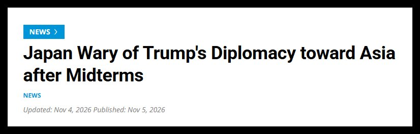
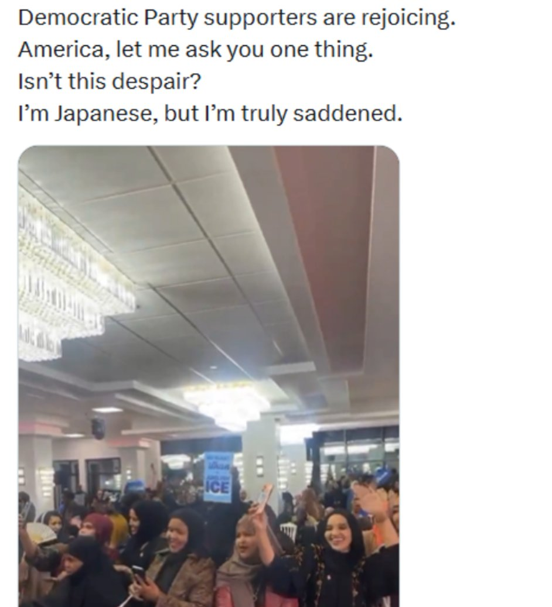
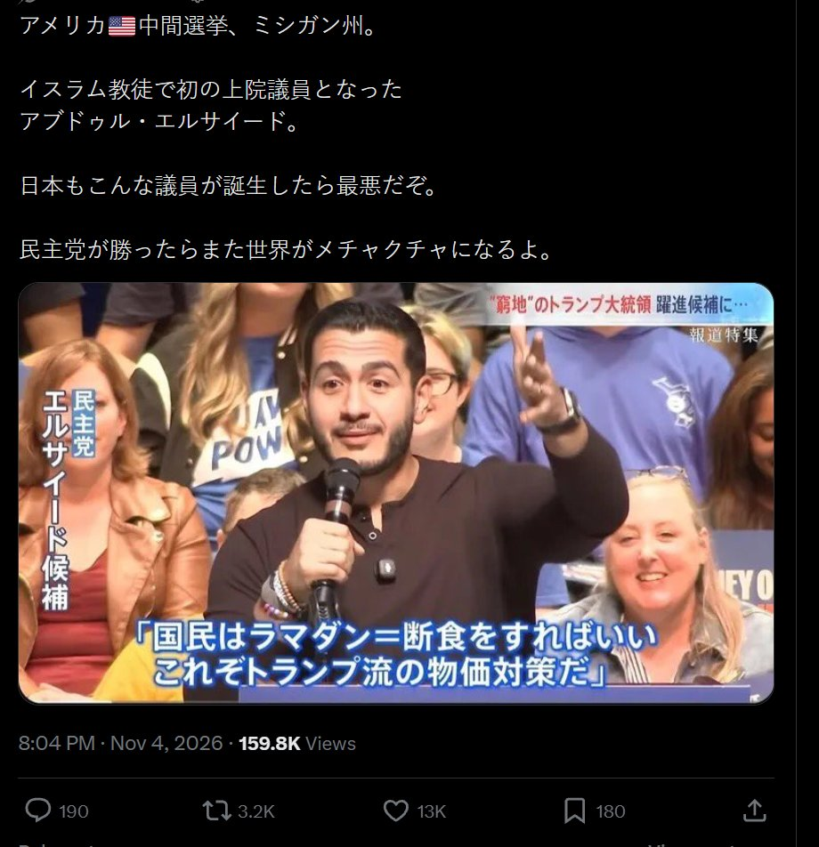
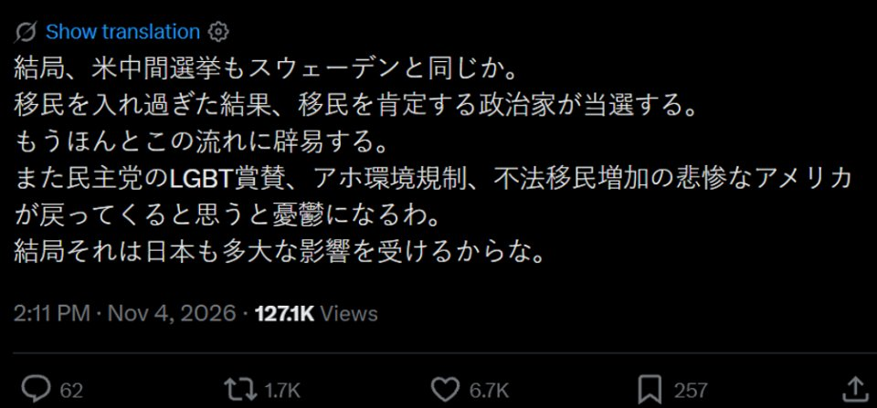
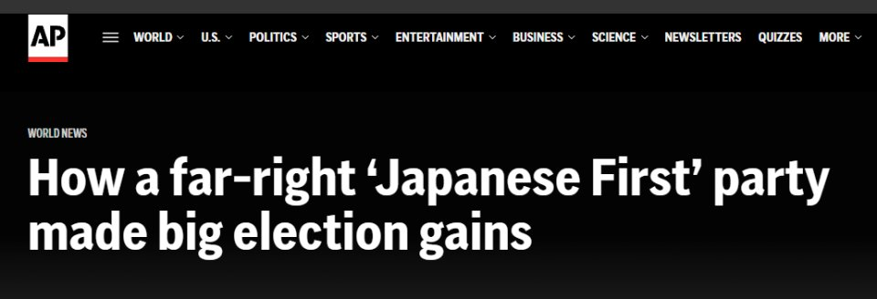
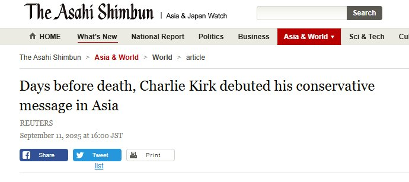

本文根据环球时报视频号“瞎白话”栏目视频《共和党大败后，日本网上出现荒唐一幕！》（2026 年 11 月 6 日）整理。视频链接：https://weixin.qq.com/sph/ArzaFIDerz

当地时间 11 月 3 日，美国中期选举以共和党的大败落幕。而在海外，日本成为了对此反应相当激烈的国家之一。不仅日本官方有人担心地缘利益受损，部分日本右翼账号更在社交平台上肆意攻击胜选的美国少数族裔参选人，甚至叫嚣“昨天是欧洲，今天是美国，明天就是日本”。

由于相关社交平台都配有“自动翻译”功能，这些极端言论已经引起了美国和其他国家网民的围观。

从路透社和日本时事通信社等媒体的报道来看，日本政府目前的担忧在于，失去了对国内政治议题控制力的美国总统特朗普，可能会将更多力量用于外交事务，但这可能会损害日本的利益。

有日本官方人员就对这些媒体透露，如果特朗普为了给自己任期的最后两年打造一些“政治遗产”，寻求进一步改善与俄罗斯、朝鲜等国的关系，可能导致日本被排除在外交议程之外，在东亚地缘政治中被边缘化。

与此同时，日本网络右翼民粹账号则陷入了另一种狂欢。他们宣称“外国移民”已经夺舍了美国，此次的选举结果就是证明。这些右翼民粹账号扬言，如果日本不推行“日本人至上”的政策，就会步入美欧后尘，落入“外国人”之手。

为了佐证这种荒诞的焦虑，这些日本右翼民粹账号特意截取了美国的少数族裔参选人与选民庆祝胜选的画面，并使用带有强烈种族主义和排外色彩的言论进行攻击。这些帖文已经获得了不少其他右翼民粹账号的点赞。

下面就是日本右翼账号在 X 上发的帖子。先看这一条，一个日本账号转发了民主党支持者庆祝胜选的画面，配文写道：

> “民主党的支持者在欢呼。美国啊，让我问你一件事。这难道不是绝望吗？我是日本人，但我真的很难过。”
>
> （原文为 X 自动翻译的英文：Democratic Party supporters are rejoicing. America, let me ask you one thing. Isn't this despair? I'm Japanese, but I'm truly saddened.）

再看这条密歇根州的帖子。配图是首位穆斯林参议员阿卜杜勒·埃尔-赛义德（Abdul El-Sayed）发表胜选讲话的画面，日文配文写道：

> “美国🇺🇸中期选举，密歇根州。伊斯兰教徒中首位当选参议员的阿卜杜勒·埃尔-赛义德。日本要是也出现这样的议员就糟透了。民主党要是赢了，世界又会乱成一团。”
>
> （日文原文：アメリカ🇺🇸中間選挙、ミシガン州。イスラム教徒で初の上院議員となったアブドゥル・エルサイード。日本もこんな議員が誕生したら最悪だぞ。民主党が勝ったらまた世界がメチャクチャになるよ。）

还有这一条，直接把美国和瑞典相提并论：

> “说到底，美国中期选举和瑞典也一样。接纳了太多移民，结果就是肯定移民的政客当选。真的受够了这种趋势。一想到民主党那套赞美 LGBT、愚蠢的环境管制、非法移民增加的悲惨美国又要回来了，就觉得郁闷。说到底，日本也会受到很大影响。”
>
> （日文原文：結局、米中間選挙もスウェーデンと同じか。移民を入れ過ぎた結果、移民を肯定する政治家が当選する。もうほんとこの流れに辟易する。また民主党のLGBT賞賛、アホ環境規制、不法移民増加の悲惨なアメリカが戻ってくると思うと憂鬱になるわ。結局それは日本も多大な影響を受けるからな。）

事实上，日本右翼民粹势力近些年一直主动“拜师”美国的右翼民粹势力。据美联社和《朝日新闻》报道，日本右翼政党“参政党”不仅全盘借鉴了美方反移民、反多元化的政治路线，夸大外国人对日本的危害，推崇日本人至上的理念，还曾邀请已于去年遇刺身亡的美国右翼民粹势力代表性人物查理·柯克赴日演讲、传授经验。

而自高市早苗去年成为日本首相后，有意迎合国内右翼民粹势力的她，则给该势力极具争议性的政治诉求提供了更大的舞台。同时，高市对美国政府的卑躬屈膝，也进一步加深了日美右翼民粹势力的往来。因此，当美国共和党在中期选举中落败时，日本右翼的心态也跟着崩了。

这些日本右翼民粹账号大多在社交平台 X 上发帖，得益于该平台的自动翻译功能，这些充斥着排外情绪的右翼民粹言论被自动翻译成了英语等语言，并被算法推给了美国乃至更多国家的网民面前，让全世界得以直观“欣赏”高市治下的日本网络生态了。
